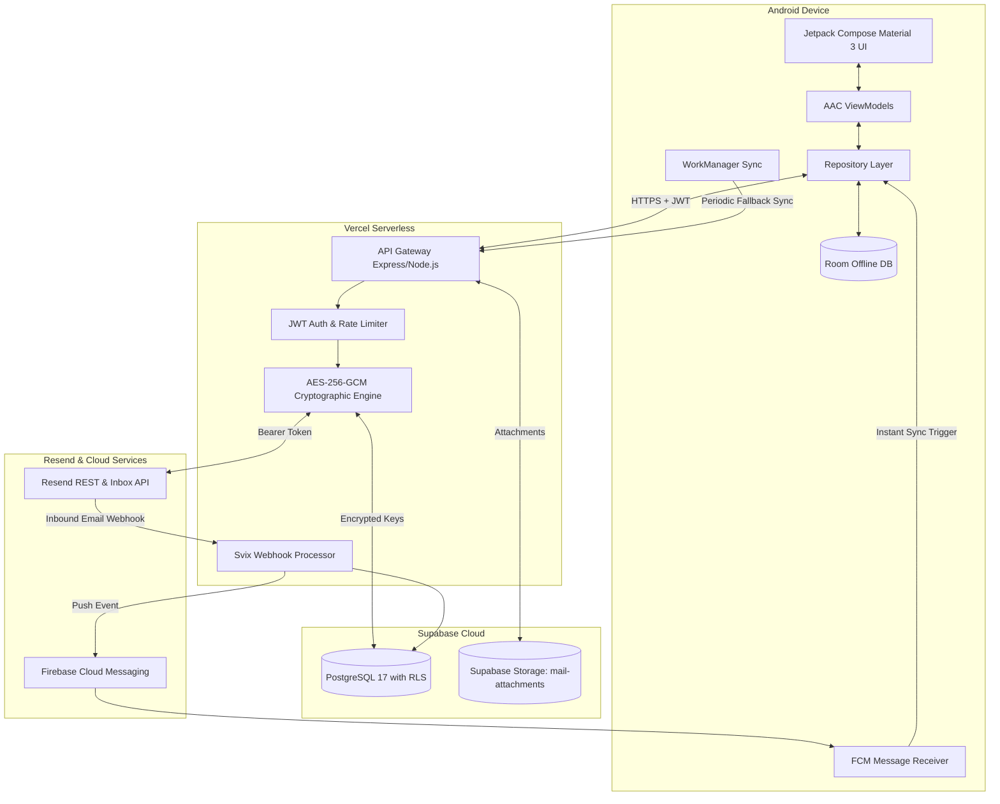
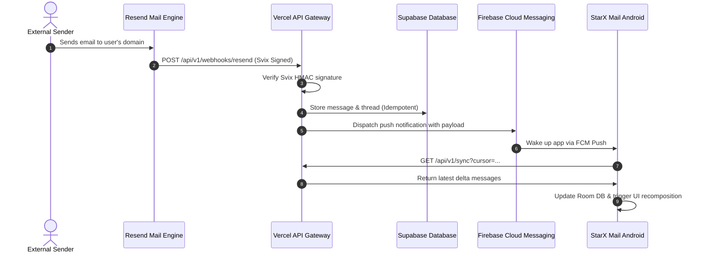

# StarX Mail — Enterprise Android Email Client Powered by Resend

<p align="center">
  
</p>

<p align="center">
  <a href="https://github.com/Tara1903/StarX-Mail/releases"></a>
  <a href="https://android.com"></a>
  <a href="https://kotlinlang.org"></a>
  <a href="https://developer.android.com/jetpack/compose"></a>
  <a href="https://resend.com"></a>
  <a href="https://vercel.com"></a>
  <a href="https://supabase.com"></a>
  <a href="https://opensource.org/licenses/Apache-2.0"></a>
  <a href="https://github.com/Tara1903/StarX-Mail/actions"></a>
</p>

---

## 📖 Overview

**StarX Mail** is an enterprise-grade, production-ready native Android email client built with modern Kotlin, Jetpack Compose, Material 3, and Clean Architecture, powered natively by the official **Resend** email platform.

Designed to deliver a fluid, Gmail-caliber email experience, StarX Mail combines a reactive native Android front end with an autoscaling **Vercel Serverless** API Gateway backed by **Supabase PostgreSQL** and **Supabase Storage**. Inbound emails are handled with sub-second latency through verified **Svix Webhooks** and **Firebase Cloud Messaging (FCM)** push notifications, with an offline-first **Room** cache and **WorkManager** background sync.

---

## 🚀 Live Production Infrastructure

The StarX Mail production cloud stack is deployed and actively operating:

| Component | Target / Host | Status | Details |
| :--- | :--- | :--- | :--- |
| **Backend API Gateway** | [`https://starx-mail-backend.vercel.app`](https://starx-mail-backend.vercel.app) | **LIVE** | Vercel Serverless (Express / Node.js ES2022) |
| **Health Check Endpoint**| [`/api/v1/health`](https://starx-mail-backend.vercel.app/api/v1/health) | **200 OK** | Real-time monitoring and container health |
| **Database Cluster** | `db.iotuxpcqewdzvqzncpad.supabase.co` | **LIVE** | Supabase Postgres 17 (`ap-northeast-1`), RLS enabled on all 11 tables |
| **Encrypted File Storage** | Bucket `mail-attachments` | **ACTIVE** | Private, 40 MB max file size, time-limited signed URLs |
| **Inbound Webhook** | [`/api/v1/webhooks/resend`](https://starx-mail-backend.vercel.app/api/v1/webhooks/resend) | **ACTIVE** | Svix signature verification + Idempotency tracking |
| **Push Notifications** | Firebase Cloud Messaging (FCM) | **ACTIVE** | Instant push on `email.received` + WorkManager fallback |
| **Android Release APK** | [GitHub Releases](https://github.com/Tara1903/StarX-Mail/releases) | **SIGNED** | Scheme v2 Signed, R8 Optimized (4.96 MB) |

### 📦 Production Release APK Details
- **File**: `StarX-Mail-release.apk`
- **Size**: `5,200,133 bytes` (~4.96 MB)
- **Minification & Obfuscation**: R8 fully enabled (`isMinifyEnabled = true`, `isShrinkResources = true`)
- **Signature Scheme**: APK Signature Scheme v2 (Signed with RSA 2048-bit key)
- **SHA-256 Checksum**:
  ```
  8231E8F92FFF5B735C2377CBFFA956334EE081EC2A3EA951B2C387DEAE3251B0
  ```

---

## 🌟 Key Features

### 1. Generic Multi-Tenant & Any-Domain Support
- **Bring Your Own Resend API Key**: Anyone can download StarX Mail and connect using **their own** Resend API key (`re_...`) with zero backend self-hosting required (or optionally configure their own custom backend URL).
- **Full Multi-Tenant Isolation**: Every user's API key, emails, drafts, attachments, and webhooks are strictly isolated in Supabase PostgreSQL by `account_id` and AES-256-GCM encryption.
- **In-App Custom Domain & DNS Management**: Add custom domains directly inside Settings (`POST /api/v1/setup/domains`), tap to copy SPF/DKIM/MX DNS records, and trigger live verification (`POST /api/v1/setup/domains/:domainId/verify`).
- **Any Verified Sender Address**: Send from your verified domain aliases (`hello@yourdomain.com`, `support@yourdomain.com`, etc.) via smart presets or custom sender address input in Compose.
- **Automated Provisioning**: Automatically discovers domains & inboxes, registers tenant-scoped Svix webhooks (`/api/v1/webhooks/resend/:accountId`), and synchronizes conversations.

### 2. Full-Featured Email Client
- **Unified & Organized Inboxes**: Email list with sender avatars, real-time unread badges, paperclip attachment indicators, star toggles, and pull-to-refresh.
- **Conversation Threading**: Groups messages by thread with full chronological history and RFC 5322 `In-Reply-To` and `References` headers.
- **Rich Email Viewer**: Responsive HTML rendering with active script stripping, CSS normalization, inline reply/reply-all/forward actions, and attachment downloads.
- **Rich Composer**: From-address selector (verified custom domains & inboxes), recipient chip fields (To, CC, BCC), rich HTML/plain text, file attachment picker, autosave drafts, and instant delivery feedback.
- **Sent & Delivery Receipts**: Outbound messages accompanied by live delivery status receipts (`Delivered`, `Bounced`, `Sent`).
- **Drafts Management**: Local autosave and cross-device sync with one-tap editing continuation.
- **Instant Offline Search**: Offline search across senders, recipients, subjects, and email bodies powered by Room FTS SQLite.
- **Mailbox Categories**: Starred, Sent, Drafts, Archive, and Trash respecting provider capabilities.

### 3. Bulletproof Security & Zero-Trust Architecture
- **Zero Client-Side API Key Exposure**: The `RESEND_API_KEY` is **never** embedded in the Android APK, BuildConfig, assets, or client network requests.
- **AES-256-GCM Encryption at Rest**: Sensitive provider credentials stored in Supabase PostgreSQL are encrypted using AES-256-GCM with random 96-bit IVs and 128-bit authentication tags.
- **Cryptographic JWT Sessions**: Android communicates with the gateway using cryptographically signed HMAC JWT tokens.
- **Svix Webhook Verification**: Inbound Resend webhook events are strictly verified using the Svix signing secret.
- **Row Level Security (RLS)**: Enforced across all 11 database tables to prevent cross-tenant or unauthorized data access.
- **Malicious Script Defense**: HTML email viewer strips `<script>`, `javascript:` URLs, and active DOM event handlers. JavaScript is explicitly disabled on the internal rendering engine.
- **Biometric Security**: Hardware-backed fingerprint and face unlock via AndroidX `BiometricPrompt`.

---

## 🏗️ Architecture & Data Flow



### Inbound Email Synchronization Flow



---

## 📁 Repository Structure

```
starx-mail/
├── android/                         # Android Client Project
│   ├── app/
│   │   ├── starx-release.keystore   # Production release keystore (RSA 2048-bit)
│   │   ├── src/main/java/app/starx/mail/
│   │   │   ├── core/                # Security, Network, Notifications, DI
│   │   │   │   ├── biometric/       # BiometricPrompt manager
│   │   │   │   ├── di/              # Hilt dependency injection modules
│   │   │   │   ├── network/         # Retrofit, OkHttp, AuthInterceptor, ErrorParser
│   │   │   │   ├── notification/    # Android 13+ Notification channels & builders
│   │   │   │   └── security/        # Secure TokenStorage (DataStore + Crypto)
│   │   │   ├── data/                # Data layer
│   │   │   │   ├── local/           # Room Database, DAOs, Entities, TypeConverters
│   │   │   │   ├── remote/          # Retrofit API definitions & DTOs
│   │   │   │   └── repository/      # Repository implementations
│   │   │   ├── domain/              # Clean Architecture domain models & interfaces
│   │   │   ├── presentation/        # Jetpack Compose UI (10 Screens) & ViewModels
│   │   │   │   ├── compose/         # Email composer screen
│   │   │   │   ├── detail/          # Email detail & conversation screen
│   │   │   │   ├── home/            # Inbox & navigation drawer
│   │   │   │   ├── inboxes/         # Domain & inbox management
│   │   │   │   ├── onboarding/      # Resend API key setup & DNS verification
│   │   │   │   ├── search/          # Search screen
│   │   │   │   └── settings/        # Account & security settings
│   │   │   └── sync/                # WorkManager periodic sync workers
│   │   └── src/test/                # Android unit tests (JUnit, Mockito, Coroutines)
│   └── gradle/                      # Version Catalog (libs.versions.toml) & Gradle Wrapper
├── backend/                         # Backend Gateway Service
│   ├── api/index.ts                 # Vercel serverless entry point
│   ├── src/
│   │   ├── config/                  # Zod schema validation & environment loader
│   │   ├── controllers/             # Express route controllers
│   │   ├── middleware/              # JWT auth, rate limiting, error handlers
│   │   ├── services/                # ResendClient, Svix Webhooks, Supabase, FCM, Logger
│   │   ├── utils/                   # AES-256-GCM encryption helpers
│   │   └── types/                   # Shared TypeScript domain contracts
│   ├── tests/                       # Vitest unit & integration test suites
│   └── vercel.json                  # Vercel deployment configuration
├── supabase/
│   └── migrations/                  # Complete PostgreSQL migration scripts (11 tables + RLS)
├── docs/                            # In-depth architectural & operational documentation
│   ├── ARCHITECTURE.md
│   ├── ENVIRONMENT_VARIABLES.md
│   ├── INTEGRATION_TESTS.md
│   ├── PRODUCTION_DEPLOYMENT.md
│   ├── RESEND_INTEGRATION.md
│   └── SECURITY_AUDIT.md
└── scripts/                         # E2E test suites and build automation scripts
```

---

## 📲 Installation & Setup

### Option 1: Direct APK Download (Recommended)
1. Download the signed release APK from the [GitHub Releases](https://github.com/Tara1903/StarX-Mail/releases) page:
   - **`StarX-Mail-release.apk`**
2. Transfer or download the APK directly onto your Android device running Android 10 or later.
3. Open the downloaded file and tap **Install** (allow installation from unknown sources if prompted).
4. Launch **StarX Mail** and enter your [Resend API Key](https://resend.com/api-keys) to get started!

### Option 2: Sideloading via ADB
If you are developing or testing with an Android phone or emulator connected via USB:

```bash
# Verify your device is connected
adb devices

# Install the signed release APK
adb install -r "android/app/build/outputs/apk/release/app-release.apk"
```

> **Troubleshooting `device unauthorized`:**
> If you see `adb.exe: device unauthorized`, check your phone's screen for the **"Allow USB debugging?"** prompt and tap **Allow** (check "Always allow from this computer"). If the prompt does not appear, restart ADB:
> ```bash
> adb kill-server
> adb start-server
> adb devices
> ```

---

## 🛠️ Building from Source

### Prerequisites
- **Android Studio** Ladybug / Hedgehog or later
- **JDK 17** (Temurin, Azul, or Oracle)
- **Node.js** 20.x or later & npm
- **Android SDK** API 34+ / Build-Tools 34.0.0

### Build Android App
```bash
# Clone the repository
git clone https://github.com/Tara1903/StarX-Mail.git
cd StarX-Mail/android

# Run unit tests
./gradlew test

# Build Debug APK
./gradlew assembleDebug

# Build Release APK (Signed with production keystore)
./gradlew assembleRelease
```
The output APKs are generated in:
- `android/app/build/outputs/apk/release/app-release.apk`
- `android/app/build/outputs/apk/debug/app-debug.apk`

### Run Backend Tests & Local Server
```bash
cd StarX-Mail/backend

# Install dependencies
npm install

# Run unit test suite
npm test

# Start local development server
npm run dev
```

---

## 🌐 API Reference Specification

All API requests (except `/health`, `/setup/connect`, and `/webhooks/resend`) require an `Authorization: Bearer <JWT>` header obtained upon initial connection.

| Method | Endpoint | Description | Auth Required |
| :--- | :--- | :--- | :---: |
| `GET` | `/api/v1/health` | Service health, version, and uptime | No |
| `POST` | `/api/v1/setup/connect` | Authenticates Resend API key, discovers domains, and returns tenant JWT session | No |
| `GET` | `/api/v1/setup/status` | Returns authenticated account status and live Resend domain verification details | Optional |
| `POST` | `/api/v1/setup/domains` | Adds a custom domain to the user's Resend account | Yes |
| `POST` | `/api/v1/setup/domains/:domainId/verify` | Triggers Resend DNS verification for a custom domain | Yes |
| `PATCH` | `/api/v1/setup/default-sender` | Updates the default `From` email address for the authenticated account | Yes |
| `GET` | `/api/v1/inboxes` | Lists all discovered Resend inboxes and supported features | Yes |
| `POST` | `/api/v1/inboxes` | Provisions a new inbox on a verified custom domain | Yes |
| `GET` | `/api/v1/emails` | Lists paginated messages with filters (`folder`, `unread`, `search`) | Yes |
| `POST` | `/api/v1/emails/send` | Sends a new email, reply, or forward via Resend | Yes |
| `GET` | `/api/v1/emails/:id` | Retrieves full email metadata, headers, attachments, and clean HTML body | Yes |
| `POST` | `/api/v1/drafts` | Creates or autosaves an email draft | Yes |
| `GET` | `/api/v1/drafts` | Retrieves all saved drafts | Yes |
| `DELETE`| `/api/v1/drafts/:id` | Deletes a saved draft | Yes |
| `GET` | `/api/v1/sync` | Delta synchronization returning all updates since given timestamp | Yes |
| `POST` | `/api/v1/webhooks/resend/:accountId` | Tenant-isolated Svix webhook endpoint for incoming emails & delivery receipts | Signature |
| `POST` | `/api/v1/notifications/token` | Registers an Android FCM push token for real-time notifications | Yes |

---

## 🗄️ Database Schema (Supabase PostgreSQL 17)

The backend uses 11 relational tables with strict foreign-key cascades, automated `updated_at` triggers, and Row Level Security:

1. **`mail_accounts`**: Stores account identifiers, email addresses, and AES-256-GCM encrypted Resend API keys.
2. **`mail_inboxes`**: Discovered and provisioned Resend inboxes.
3. **`mail_threads`**: Conversation groupings with participant tracking and chronological bounds.
4. **`mail_messages`**: Normalized email records with headers, body references, and read/star flags.
5. **`mail_attachments`**: Attachment metadata, MIME types, and Supabase Storage bucket paths.
6. **`mail_drafts`**: Cloud-synced draft compositions with recipient arrays.
7. **`mail_webhook_events`**: Idempotency ledger preventing duplicate webhook processing.
8. **`mail_sync_state`**: Per-account sync cursors and timestamps.
9. **`mail_push_tokens`**: Active FCM registration tokens with device metadata.
10. **`mail_sessions`**: Active JWT session tokens with device fingerprints.
11. **`mail_audit_logs`**: Security event logs for authentication, configuration changes, and errors.

---

## 🧪 Testing & Quality Assurance

- **Android Unit Tests**: 10/10 JUnit unit tests passing across formatters, HTML sanitization, and repository use cases.
  ```bash
  cd android && ./gradlew test
  ```
- **Backend Tests**: 15/15 Vitest unit & integration tests passing (multi-tenant isolation, AES-256-GCM encryption, custom domain provisioning, rate limiting, and webhook idempotency).
  ```bash
  cd backend && npm test
  ```
- **Live Production E2E Suite**: End-to-end verification against the live production Vercel + Supabase deployment:
  ```bash
  node scripts/test-production-e2e.js
  ```
  *Result: 11/11 E2E scenarios passing against `https://starx-mail-backend.vercel.app`.*

---

## 🔒 Security & Vulnerability Reporting

StarX Mail is engineered with defense-in-depth principles:
- No third-party API credentials are ever exposed to the Android client.
- Sensitive values are encrypted at rest with AES-256-GCM before database insertion.
- All webhook payloads are cryptographically validated against Svix signatures.
- For complete security documentation, see [SECURITY_AUDIT.md](docs/SECURITY_AUDIT.md).

---

## 📄 License

This project is licensed under the **Apache License 2.0**. See the [LICENSE](LICENSE) file for details.
