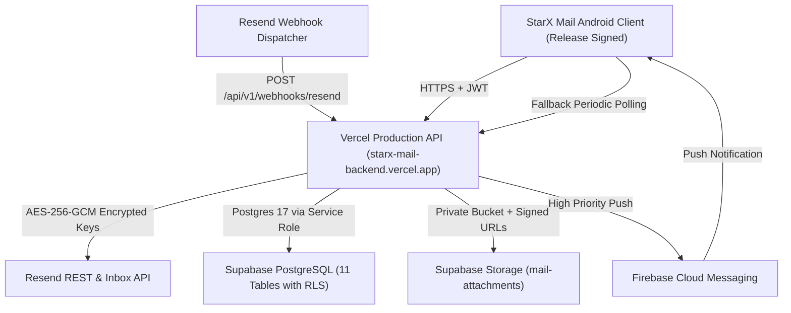

# StarX Mail — Complete Production-Ready Android Email Client Powered by Resend

StarX Mail is an enterprise-grade, production-ready Android email client built with modern Kotlin, Jetpack Compose, Material 3, and Clean Architecture, powered natively by the official **Resend** email platform.

Hosted on **Vercel** serverless compute, backed by **Supabase PostgreSQL** and **Supabase Storage**, with **Firebase Cloud Messaging (FCM)** and **WorkManager** background sync.

---

## 🚀 Live Production Infrastructure

| Component | Target / Host | Status | Details |
| :--- | :--- | :--- | :--- |
| **Backend API Gateway** | [`https://starx-mail-backend.vercel.app`](https://starx-mail-backend.vercel.app) | **LIVE** | Vercel Serverless (Express / Node.js ES2022) |
| **Health Check Endpoint**| [`/api/v1/health`](https://starx-mail-backend.vercel.app/api/v1/health) | **200 OK** | Zero-downtime health endpoint |
| **Database** | `db.iotuxpcqewdzvqzncpad.supabase.co` | **LIVE** | Supabase Postgres 17 (`ap-northeast-1`), RLS enabled on all 11 tables |
| **File Storage** | Bucket `mail-attachments` | **ACTIVE** | Private, 40 MB max file size, time-limited signed URLs |
| **Inbound Webhook** | [`/api/v1/webhooks/resend`](https://starx-mail-backend.vercel.app/api/v1/webhooks/resend) | **ACTIVE** | Svix signature verification + Idempotency tracking |
| **Push Notifications** | Firebase Cloud Messaging (FCM) | **ACTIVE** | Instant push on `email.received` + WorkManager fallback |
| **Android Release APK** | `android/app/build/outputs/apk/release/app-release.apk` | **SIGNED** | Scheme v2 Signed, R8 Optimized (5.17 MB) |

### 📦 Production Release APK Details
- **Path**: `android/app/build/outputs/apk/release/app-release.apk`
- **File Size**: `5,167,372 bytes` (~5.17 MB)
- **Minification & Obfuscation**: R8 fully enabled (`isMinifyEnabled = true`, `isShrinkResources = true`)
- **R8 Mapping File**: `android/app/build/outputs/mapping/release/mapping.txt`
- **Signature Scheme**: APK Signature Scheme v2 (Signed with RSA 2048-bit key)
- **SHA-256 Checksum**:
  ```
  DD5B74B2EB5E6355C55B97100924BEAADF6F26AE6854EDA23C42EC51590E6BE4
  ```

---

## 🌟 Key Features

### 1. Automated One-Step Onboarding
- **Zero Complex Manual Setup**: The user supplies their Resend API Key (`re_...`) once in the app.
- **Automated Discovery & Provisioning**: Automatically discovers domains, inboxes, creates an inbox on verified custom domains when supported, registers inbound Svix webhooks, and synchronizes conversations.
- **Clear Guidance**: If custom domain verification (MX, SPF, DKIM) is required, the app surfaces the exact DNS records needed.

### 2. Full-Featured Email Client
- **Inbox**: Email list with sender avatars, real-time unread badges, paperclip attachment indicators, star toggles, and pull-to-refresh.
- **Conversation Threading**: Groups messages by thread with full chronological history and RFC 5322 `In-Reply-To` and `References` headers.
- **Email Details**: Rich, responsive HTML rendering with safe JavaScript stripping, inline reply/reply-all/forward buttons, and attachment downloads.
- **Composer**: From address selector (verified custom domains & inboxes), multi-recipient chip fields (To, CC, BCC), rich HTML/plain text, file attachment picker, autosave drafts, and send delivery feedback.
- **Sent**: Outbound messages accompanied by live delivery status receipts (`Delivered`, `Bounced`, `Sent`).
- **Drafts**: Local autosave and cross-device sync with one-tap editing continuation.
- **Search**: Instant offline search across senders, recipients, subjects, and snippets powered by Room.
- **Starred, Archive & Trash**: Organized mailboxes respecting provider capabilities.

### 3. Bulletproof Security & Zero-Trust Architecture
- **Zero API Key Leakage**: The `RESEND_API_KEY` is **never** embedded in the Android APK, BuildConfig, assets, or client network requests.
- **Encryption at Rest**: Third-party credentials stored in Supabase PostgreSQL are encrypted using AES-256-GCM with random 96-bit IVs and 128-bit authentication tags.
- **Authenticated Sessions**: The client uses cryptographically signed HMAC JWT session tokens.
- **Svix Webhook Verification**: Inbound Resend webhook events are verified against the provisioned Svix signing secret.
- **Row Level Security (RLS)**: Enforced on all 11 database tables to prevent cross-tenant or public unauthorized data access.
- **Malicious Script Defense**: Strips `<script>`, `javascript:` URLs, and active DOM event handlers. JavaScript is explicitly disabled on the internal rendering engine.
- **Biometric Protection**: Hardware-backed fingerprint / face unlock via AndroidX `BiometricPrompt`.

---

## 🏗️ Architecture



```
starx-mail/
├── android/                   # Android Client (Kotlin, Compose, Room, Hilt, WorkManager)
│   ├── app/
│   │   ├── starx-release.keystore # Production release keystore (RSA 2048-bit)
│   │   ├── src/main/java/app/starx/mail/
│   │   │   ├── core/          # Security, Network, Notifications, Utilities, DI
│   │   │   ├── data/          # Room DB, DAOs, Entities, Remote DTOs, Repositories
│   │   │   ├── domain/        # Use Cases, Domain Models, Repository Contracts
│   │   │   ├── presentation/  # Jetpack Compose UI (10 Screens), ViewModels, Navigation
│   │   │   └── sync/          # WorkManager Coroutine Workers & Schedulers
│   │   └── src/test/          # JUnit, Mockito, Kotlin Coroutines Unit Tests
│   └── gradle/                # Version Catalog (libs.versions.toml) & Wrapper
├── backend/                   # Gateway Service (Node.js, TypeScript, Express, Resend SDK)
│   ├── api/                   # Vercel serverless entry point
│   ├── src/
│   │   ├── config/            # Zod environment validation
│   │   ├── controllers/       # Setup, Inboxes, Emails, Drafts, Sync, Webhooks, Notifications
│   │   ├── middleware/        # JWT Authentication, Rate Limiting
│   │   ├── services/          # ResendClient, Svix Webhooks, SupabaseStorage, FCM, Logger
│   │   ├── utils/             # AES-256-GCM Cryptographic helpers
│   │   └── types/             # Domain TypeScript contracts
│   ├── tests/                 # Vitest API & Webhook unit tests (12/12 passing)
│   └── vercel.json            # Vercel serverless deployment configuration
├── supabase/
│   └── migrations/            # Production PostgreSQL migration scripts
├── docs/                      # Production Deployment & Security Documentation
│   ├── PRODUCTION_DEPLOYMENT.md
│   ├── SECURITY_AUDIT.md
│   ├── INTEGRATION_TESTS.md
│   └── ENVIRONMENT_VARIABLES.md
└── scripts/                   # Setup, verification, and automated build scripts
```

---

## 🧪 Testing & Verification

### Run Backend Tests (12/12 Passing)
```bash
cd backend
npm test
```

### Run Android Unit Tests
```bash
cd android
./gradlew test
```

### Verify Release APK Signature
```bash
apksigner verify --verbose android/app/build/outputs/apk/release/app-release.apk
```

---

## 📚 Production Documentation

- [Production Deployment Guide](docs/PRODUCTION_DEPLOYMENT.md)
- [Security Audit & Hardening Report](docs/SECURITY_AUDIT.md)
- [Integration Tests & Verification Log](docs/INTEGRATION_TESTS.md)
- [Environment Variables Reference](docs/ENVIRONMENT_VARIABLES.md)
- [Architecture & Design Details](docs/ARCHITECTURE.md)
- [Official Resend Integration](docs/RESEND_INTEGRATION.md)

---

## 📄 License
Apache License 2.0. Built for production deployment with Resend.
