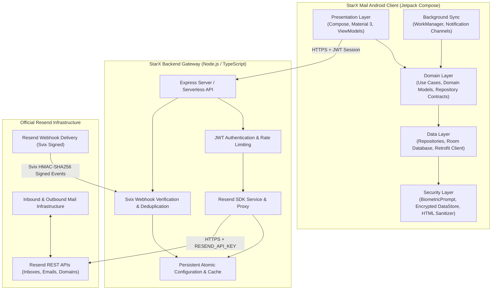

# StarX Mail — Architecture & Technical Specifications

StarX Mail is a production-oriented Android email client powered by the official Resend email platform.

---

## 1. High-Level Architecture Overview

StarX Mail adheres to Clean Architecture principles divided into two independently deployable components:

---

## 2. Android Client Architecture

### 2.1 Clean Architecture Layers
- **Presentation (`app.starx.mail.presentation`)**:
  - Jetpack Compose declarative UI built with Material 3 Expressive.
  - State hoisting using Kotlin `StateFlow` and unidirectional data flow (UDF).
  - Navigation Compose graph with typed route arguments.
  - 10 full-featured screens:
    1. `OnboardingScreen`: Resend API key setup, automated discovery & validation.
    2. `InboxScreen`: Primary email view, pull-to-refresh, unread badges, swipe actions.
    3. `EmailDetailsScreen`: Thread context, safe HTML rendering, attachment download.
    4. `ComposeScreen`: Multi-recipient selector (To, CC, BCC), From address selector, rich text, attachment picker, autosave.
    5. `SentScreen`: Outbound history with live delivery status badges (`Delivered`, `Bounced`).
    6. `DraftsScreen`: Saved drafts with resume editing capability.
    7. `StarredScreen`: Starred messages.
    8. `ArchiveTrashScreen`: Dedicated tabs for archived and deleted messages.
    9. `SearchScreen`: Local Room search across senders, subjects, and snippets.
    10. `SettingsScreen`: Connected account info, inboxes management, domain DNS records breakdown, biometric lock, theme selection.

- **Domain (`app.starx.mail.domain`)**:
  - Pure Kotlin business logic independent of Android frameworks.
  - Granular Use Cases: `GetEmailsUseCase`, `SendEmailUseCase`, `ReplyEmailUseCase`, `ForwardEmailUseCase`, `SaveDraftUseCase`, `ToggleStarUseCase`, `MarkReadUseCase`, `SyncEmailsUseCase`, `ConnectAccountUseCase`.
  - Repository interfaces defining contracts for data operations.

- **Data (`app.starx.mail.data`)**:
  - **Local**: Room database (`StarXDatabase`) with 6 entities (`EmailEntity`, `AttachmentEntity`, `DraftEntity`, `AccountEntity`, `InboxEntity`, `SyncStateEntity`). Provides offline-first caching and instant local search.
  - **Remote**: Retrofit 2 + OkHttp 3 with `AuthInterceptor`, JSON converters, timeout management, and structured logging.
  - **Repository**: Single source of truth pattern reconciling local cache with remote API deltas.

- **Core & Security (`app.starx.mail.core`)**:
  - `BiometricAuthManager`: Hardware-backed biometric protection with system credential fallback.
  - `HtmlSanitizer`: Strips malicious `<script>` tags, `javascript:` URLs, and active DOM event handlers.
  - `NotificationHelper`: System notification channels for incoming emails and delivery receipts.

---

## 3. Backend Gateway Architecture

### 3.1 Security & Zero-Trust Architecture
- **Secret Isolation**: The `RESEND_API_KEY` is **never** transmitted to or stored within the Android application or APK build assets.
- **Session Tokens**: Clients receive a cryptographically signed HMAC JWT session token valid for authenticated device communication.
- **Webhook Signature Verification**: Resend utilizes Svix for webhook signing. Every incoming event is verified using `svix-id`, `svix-timestamp`, and `svix-signature` headers against the provisioned signing secret.
- **Deduplication / Idempotency**: Processed event IDs are indexed and cached to prevent replay attacks or duplicate deliveries.
- **Rate Limiting**: Protects against denial-of-service and provider API quota exhaustion.
