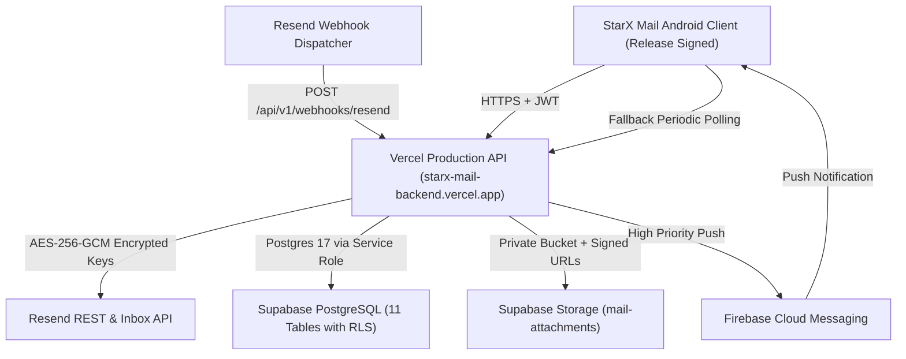

# StarX Mail — Production Deployment Guide

## 1. System Overview

StarX Mail is an enterprise-grade Android email client powered by Resend email infrastructure, hosted on Vercel serverless compute and backed by Supabase PostgreSQL and Supabase Storage.



---

## 2. Live Infrastructure Coordinates

| Component | Target / Host | Status | Details |
| :--- | :--- | :--- | :--- |
| **Backend API** | `https://starx-mail-backend.vercel.app` | **ONLINE** | Production Vercel Serverless (Express / Node.js ES2022) |
| **Health Check** | `https://starx-mail-backend.vercel.app/api/v1/health` | **200 OK** | Zero-downtime health endpoint |
| **Database** | `db.iotuxpcqewdzvqzncpad.supabase.co` | **ONLINE** | Supabase Postgres 17 (`ap-northeast-1`), RLS Enabled |
| **Storage Bucket** | `mail-attachments` | **ACTIVE** | Private, 40 MB max file size, time-limited signed URLs |
| **Webhook Endpoint**| `https://starx-mail-backend.vercel.app/api/v1/webhooks/resend` | **ACTIVE** | Svix signature verification + Idempotency |
| **Android Release APK** | `android/app/build/outputs/apk/release/app-release.apk` | **SIGNED** | Scheme v2 Signed, R8 Optimized (5.17 MB) |

---

## 3. Database Architecture & Schema

PostgreSQL migrations are located at:
- `supabase/migrations/20261111000000_starx_mail_schema.sql`
- `backend/src/db/schema.sql`

### Tables Provisioned:

1. **`mail_accounts`**: Connected accounts, encrypted Resend credentials, masked API key, default from address, webhook provisioning state.
2. **`mail_inboxes`**: Provisioned inboxes, email addresses, names, forwarding configuration, and operational status.
3. **`mail_threads`**: Conversation groupings, participant metadata, read/star statuses, and last activity timestamps.
4. **`mail_messages`**: Complete message records, recipient arrays (JSONB), headers, snippets, body contents, and delivery tracking.
5. **`mail_attachments`**: Attachment metadata, size, MIME type, storage path references in Supabase Storage, and fallback caches.
6. **`mail_drafts`**: Draft states, recipients, drafts body, attachment attachments.
7. **`mail_webhook_events`**: Webhook event idempotency tracking and error logs.
8. **`mail_sync_state`**: Delta sync cursors and synchronization timestamps per account.
9. **`mail_push_tokens`**: FCM device tokens for background notification dispatch.
10. **`mail_sessions`**: User authentication sessions and hashed JWT tokens.
11. **`mail_audit_logs`**: Security audit trail with IP address and action timestamps.

### Row Level Security (RLS)
All 11 tables enforce `ROW LEVEL SECURITY`. Public anonymous access via the Supabase client anon key is strictly prohibited. Only the Vercel backend using `SUPABASE_SERVICE_ROLE_KEY` has read/write privileges.

---

## 4. Android Release Deployment

### Build Artifact Details:
- **Package Name**: `app.starx.mail`
- **Output File**: `android/app/build/outputs/apk/release/app-release.apk`
- **File Size**: `5,167,372 bytes` (~5.17 MB)
- **Minification**: R8 enabled (`isMinifyEnabled = true`, `getDefaultProguardFile("proguard-android-optimize.txt")`)
- **R8 Mapping File**: `android/app/build/outputs/mapping/release/mapping.txt` (38 MB)
- **SHA-256 Checksum**:
  ```
  DD5B74B2EB5E6355C55B97100924BEAADF6F26AE6854EDA23C42EC51590E6BE4
  ```

### Signature Verification:
Signed with RSA 2048-bit key (`starx-mail`) valid for 10,000 days.
```bash
apksigner.bat verify --verbose android/app/build/outputs/apk/release/app-release.apk
# Result: Verifies (APK Signature Scheme v2: true)
```

### Installation Command:
```bash
adb install -r android/app/build/outputs/apk/release/app-release.apk
```

---

## 5. Webhook Deployment & Verification

The webhook endpoint is reachable at:
```http
POST https://starx-mail-backend.vercel.app/api/v1/webhooks/resend
```

### Features:
- **Svix Signature Verification**: Verifies `svix-id`, `svix-timestamp`, and `svix-signature` headers against `WEBHOOK_SIGNING_SECRET`.
- **Idempotency Guarantee**: Every event ID is recorded in `mail_webhook_events`. Duplicates are acknowledged (`200 OK`) and ignored.
- **Push Notification Trigger**: Dispatches FCM notification to registered Android devices on incoming emails (`email.received`).
- **Resend Delivery Events**: Handles `email.sent`, `email.delivered`, `email.bounced`, and `email.complained`.
